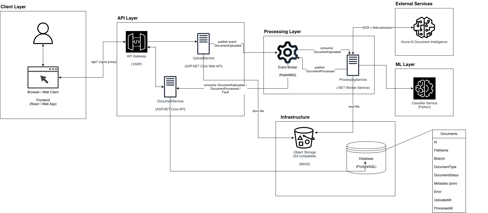

# AI Document Processing Platform

[](https://github.com/maksluczak/document-ai-platform/actions/workflows/ci.yml)

## Project Overview

**AI Document Processing Platform** is a microservices-based system that classifies uploaded PDF documents and extracts structured data from them.

A document goes through three steps: OCR, classification by a self-trained model, and field extraction by Azure AI Document Intelligence. The project demonstrates event-driven architecture, asynchronous processing with retries, integration with external AI services, and running the same system on Docker Compose and on a local Kubernetes cluster.

---

## System Architecture



* **Microservices Architecture:** Upload, Processing, and Document services operate independently.
* **Event-Driven Communication:** Services communicate via RabbitMQ events.
* **API Gateway:** YARP routes requests from the frontend to backend services.
* **Asynchronous Processing:** AI processing runs in a background consumer.
* **Classifier Service:** A separate Python service decides the document type before data extraction.

### Document flow

1. The frontend sends PDF files to `POST /api/upload`.
2. **UploadService** stores each file in MinIO and publishes a `DocumentUploaded` event.
3. **DocumentService** saves the document with status `Processing`.
4. **ProcessingService** reads the text with Azure OCR, asks the classifier for the document type, extracts fields with the matching Azure model, and publishes `DocumentProcessed`.
5. **DocumentService** updates the document to `Completed` with its type and fields.
6. If processing fails after all retries, DocumentService marks the document as `Failed` and stores the error message.

---

## Key Features

### Document Upload
* **File Upload API:** Upload one or more PDF documents through a single endpoint.
* **Object Storage:** Files are stored in MinIO.
* **Event Publishing:** Each upload triggers a `DocumentUploaded` event.

### AI Processing
* **Background Consumer:** ProcessingService consumes events from RabbitMQ.
* **OCR:** Text is read from the document using Azure AI Document Intelligence.
* **Classification:** A fine-tuned DistilBERT model assigns one of eight types: `invoice`, `receipt`, `bank_statement`, `tax_document`, `legal`, `hr`, `logistics`, `other`.
* **Structured Data:** The document type selects the Azure model used to extract fields (e.g. amount, date, vendor).

### Reliability
* **Retries:** Transient errors (network, HTTP 429, 5xx) are retried up to 5 times with exponential backoff. Permanent errors such as an invalid Azure key (HTTP 401) are not retried.
* **Visible failures:** Every document has a status: `Processing`, `Completed`, or `Failed` with the error message shown in the document list.
* **Idempotent consumers:** Repeated or out-of-order events do not create duplicates or overwrite a completed document.

### Data Storage
* **Metadata Storage:** Processed documents and their extracted fields are saved in PostgreSQL (fields as `jsonb`).
* **Document List:** The frontend shows documents with their status, type, and fields.

---

## Technologies Used

### Backend
* **.NET 10 (C#)** – Core backend framework
* **Entity Framework Core** – ORM for database operations
* **MassTransit** – Messaging abstraction for RabbitMQ
* **YARP** – API gateway

### Machine Learning
* **Python + FastAPI** – Classifier service
* **DistilBERT (Hugging Face Transformers)** – Document type classification
* **Azure AI Document Intelligence** – OCR and document data extraction

### Frontend
* **React + Vite** – Lightweight frontend interface

### Infrastructure
* **PostgreSQL** – Relational database
* **RabbitMQ** – Event bus for service communication
* **MinIO** – S3-compatible object storage for documents
* **Docker Compose** – Local environment started with one command
* **Kubernetes (kind)** – The same system on a local cluster, plain YAML manifests
* **GitHub Actions** – Build, tests, and Docker images on every push

### Testing
* **xUnit + Moq** – Unit tests
* **Testcontainers** – Consumer tests against a real PostgreSQL in Docker
* **WebApplicationFactory + MassTransit Test Harness** – Whole DocumentService tested in memory
* **pytest** – Classifier API tests

---

## Local Setup

### Requirements

- Docker with Compose v2
- Python 3.12 (to download the classifier model)
- An Azure AI Document Intelligence resource (endpoint + key)

For running services or tests outside Docker: .NET SDK 10 and Node 22.

### 1. Clone the repository

```bash
git clone https://github.com/maksluczak/document-ai-platform.git
cd document-ai-platform
cp .env.example .env
```

### 2. Create an Azure AI Document Intelligence key

The free tier (F0) is enough. With the Azure CLI:

```bash
az login
az group create --name rg-document-ai --location westeurope
az cognitiveservices account create \
    --name <unique-name> --resource-group rg-document-ai \
    --kind FormRecognizer --sku F0 --location westeurope --yes
az cognitiveservices account show --name <unique-name> \
    --resource-group rg-document-ai --query properties.endpoint -o tsv
az cognitiveservices account keys list --name <unique-name> \
    --resource-group rg-document-ai --query key1 -o tsv
```

The same resource can be created in the Azure portal: "Document Intelligence" → Create → pricing tier F0. The endpoint and key are in the "Keys and Endpoint" tab.

Put both values into `.env` as `AZURE_AI_ENDPOINT` and `AZURE_AI_KEY`.

### 3. Download the classifier model

```bash
cd server/ML/classifier-service
python3 -m venv venv
source venv/bin/activate
pip install -r requirements-dev.txt
python scripts/download_model.py
cd ../../..
```

The model is downloaded from the Hugging Face Hub (`maksluczak/document-classifier`) into `server/ML/classifier-service/model`.

### 4. Start the application

```bash
docker compose up --build
```

| Service | Address | Login |
|---|---|---|
| Application | http://localhost:3000 | – |
| RabbitMQ console | http://localhost:15672 | `RABBITMQ_USER` / `RABBITMQ_PASSWORD` from `.env` |
| MinIO console | http://localhost:9001 | `MINIO_ROOT_USER` / `MINIO_ROOT_PASSWORD` from `.env` |

### Stopping

```bash
docker compose down # stop containers, keep data
docker compose down -v # stop containers and delete data
```

---

## Running on Kubernetes (kind)

The same application can run on a local single-node [kind](https://kind.sigs.k8s.io/) cluster. The manifests in `k8s/app/` are plain YAML: one Deployment and Service per component, PersistentVolumeClaims for PostgreSQL and MinIO, readiness and liveness probes, and a Secret created from `.env`.

Requires kind and kubectl. Complete steps 1–3 of [Local Setup](#local-setup) first, then stop Docker Compose (`docker compose down`).

```bash
docker compose build
kind create cluster --config k8s/kind-config.yaml # run from the repository root
kind load docker-image --name docai \
  document-ai-platform-upload-service:latest document-ai-platform-processing-service:latest \
  document-ai-platform-document-service:latest document-ai-platform-api-gateway:latest \
  document-ai-platform-frontend:latest document-ai-platform-classifier:latest
kubectl create secret generic platform-secrets --from-env-file=.env
kubectl apply -f k8s/app/
kubectl get pods --watch
```

When all pods are `Running` and `1/1`, open http://localhost:3000.

Remove the cluster (including its data) with:

```bash
kind delete cluster --name docai
```

---

## API

All requests go through the gateway, available under the same address as the application.

| Method | Path | Description |
|---|---|---|
| `POST` | `/api/upload` | Upload one or more PDF documents (`multipart/form-data`, field `files`) |
| `GET` | `/api/documents` | List documents with status, type, and extracted fields |

---

## Tests

```bash
cd server
dotnet test
cd ..

cd server/ML/classifier-service
source venv/bin/activate
pip install -r requirements.txt -r requirements-dev.txt
pytest
cd ../../..
```

### Continuous Integration

GitHub Actions (`.github/workflows/ci.yml`) runs on every push to `main` and on every pull request:

* **backend** – format check, build with warnings as errors, all .NET tests
* **classifier** – pytest
* **client** – lint and production build
* **docker** – validates `docker-compose.yaml` and builds all images

---

## Project Structure

```
.
├── .github
│   └── workflows        # CI pipeline
├── client               # React frontend
├── docker-compose.yaml
├── docs                 # architecture diagram
├── k8s
│   ├── kind-config.yaml # local cluster definition
│   └── app              # Kubernetes manifests
└── server
    ├── ML
    │   └── classifier-service
    ├── Services
    │   ├── ApiGateway
    │   ├── DocumentService
    │   ├── ProcessingService
    │   └── UploadService
    ├── Shared
    │   └── Contracts    # event contracts shared by services
    └── Tests
```

---

## License

This project is licensed under the MIT License - [LICENSE](LICENSE).